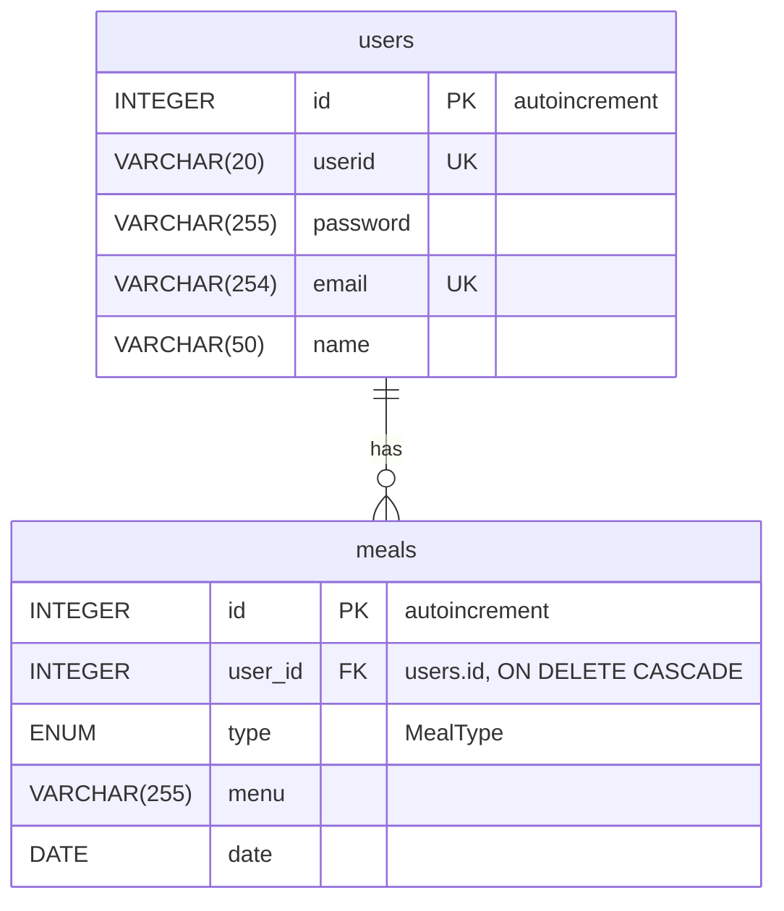

# DB 스키마 (RDB)

`models/` 의 SQLAlchemy ORM 모델로 정의된 테이블 구조입니다.
모델을 수정하면 이 문서도 함께 갱신해 주세요.

## ERD

## 테이블 상세

### `users` — [user_model.py](user_model.py)

| 컬럼 | 타입 | 제약 조건 | 설명 |
|---|---|---|---|
| `id` | INTEGER | PK, AUTO INCREMENT | 내부 식별자 |
| `userid` | VARCHAR(20) | NOT NULL, UNIQUE | 로그인 아이디 |
| `password` | VARCHAR(255) | NOT NULL | 비밀번호 |
| `email` | VARCHAR(254) | NOT NULL, UNIQUE | 이메일 |
| `name` | VARCHAR(50) | NOT NULL | 이름 |

### `meals` — [meal_model.py](meal_model.py)

| 컬럼 | 타입 | 제약 조건 | 설명 |
|---|---|---|---|
| `id` | INTEGER | PK, AUTO INCREMENT | 내부 식별자 |
| `user_id` | INTEGER | NOT NULL, FK → `users.id` (ON DELETE CASCADE) | 식단을 등록한 사용자 |
| `type` | ENUM | NOT NULL | 식사 구분 (`MealType`) |
| `menu` | VARCHAR(255) | NOT NULL | 메뉴 |
| `date` | DATE | NOT NULL | 식사 날짜 |

- **UNIQUE (`user_id`, `date`, `type`)**: 한 사용자는 같은 날짜에 같은 식사 구분을 하나만 등록할 수 있습니다.
- 사용자가 삭제되면 해당 사용자의 식단도 함께 삭제됩니다.

#### `MealType`

DB의 네이티브 `ENUM` 타입으로 저장되며, 정의된 값 외에는 DB 수준에서 거부됩니다.

| 값 | 의미 |
|---|---|
| `breakfast` | 아침 |
| `lunch` | 점심 |
| `dinner` | 저녁 |
| `late_snack` | 야식 |
| `snack` | 간식 |

## 관계

| 관계 | 설명 |
|---|---|
| `users` 1 : N `meals` | 한 사용자는 여러 식단을 가질 수 있음 |
