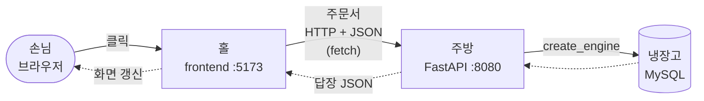
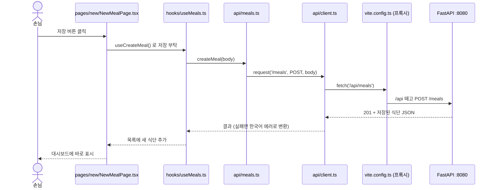
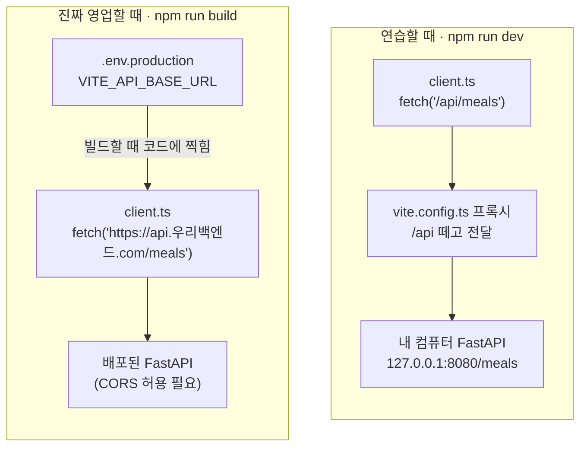

# 프론트엔드 안내서

> 프론트엔드는 식당의 **홀**이에요. 손님이 보는 화면을 그리고, 손님이 주문하면 주문서를 써서 **주방(백엔드)** 에 보내요.
> 홀에는 **냉장고(DB)** 가 없어서, 재료는 언제나 주방에 부탁해야 해요.

백엔드 쪽 설명은 [../fastapi/GUIDE.md](../fastapi/GUIDE.md)에 있어요.

## 1. 등장인물

| 비유 | 실제 | 하는 일 |
|---|---|---|
| 손님 | 브라우저 | 버튼을 누르고 화면을 봐요 |
| **홀** | `frontend` (localhost:5173) | 화면을 보여 주고, 주문서를 써서 보내요 |
| **주방** | `fastapi` (localhost:8080) | 주문서를 읽고 처리해서 돌려줘요 |
| **냉장고** | MySQL DB | 회원·식단 데이터가 보관돼 있어요 |

## 2. 큰 그림



- 주방과 냉장고는 `create_engine`으로 **계속 연결**돼 있어요.
- 홀과 주방은 연결해 두지 않아요. 필요할 때마다 **주문서 한 장을 보내고, 답장 한 장을 받으면 끝**이에요. 편지를 주고받는 것과 같아요.
- 냉장고 열쇠(`DATABASE_URL`, `create_engine`)는 **주방만** 가지고 있어요. 홀은 DB를 전혀 몰라요.

## 3. 폴더 지도

백엔드와 이야기하는 곳은 **`src/api/` 딱 한 군데**예요. 나머지는 홀 안에서 화면을 꾸미거나 기억하는 일을 해요.

```
frontend/
├─ src/
│  ├─ main.tsx          가게 문 열기     앱 시작점. React Query·로그인 담당을 출근시킴
│  ├─ App.tsx           안내판           주소 → 페이지 연결 (/login, /new, /account …)
│  │
│  ├─ pages/            방(테이블)       손님이 보는 화면. 페이지 하나 = 폴더/파일 하나
│  ├─ components/       숟가락·접시      여러 화면에서 같이 쓰는 부품 (버튼, 입력칸, 접시 그림)
│  ├─ styles/           인테리어         색·글꼴·간격
│  │
│  ├─ hooks/useMeals.ts 기억력 좋은 직원  식단 목록을 받아 와서 기억(캐시)해 둠
│  ├─ auth/             입구 직원         누가 로그인했는지 기억 + 비로그인 손님 막기
│  ├─ lib/              계산기           날짜 계산, 날짜별로 묶기 (주방과 무관)
│  │
│  └─ api/              ★ 주방과 통신
│     ├─ users.ts       주문서 양식      회원 관련 주문 (signup, getUser, updateUser, deleteUser)
│     ├─ meals.ts       주문서 양식      식단 관련 주문 (getUserMeals, createMeal)
│     ├─ client.ts      배달원           fetch()로 실제 전송 + 에러를 한국어로 변환
│     └─ types.ts       칸 이름표        주고받는 데이터 모양 (백엔드 schemas와 이름이 같아야 함)
│
├─ vite.config.ts       연습용 중계 직원  npm run dev 때만: /api 요청을 8080으로 전달
├─ .env.production      진짜 주방 주소    npm run build 때만: 백엔드 주소를 코드에 찍음
└─ dist/                포장된 완성품     npm run build 결과물. 서버에 올리는 건 이 폴더
```

## 4. 따라가 보기: "아침 · 김밥 저장" 버튼을 누르면



실제로 보내는 주문서:

```http
POST /api/meals
Content-Type: application/json

{ "user_id": 1, "type": "breakfast", "menu": "김밥", "date": "2026-11-25" }
```

## 5. 주문서 생김새

주문서에는 세 가지가 적혀 있어요.

| 칸 | 설명 | 예 |
|---|---|---|
| **어디로** | 주소(경로) | `/users/abc` |
| **무엇을** | 동사(메서드) | `GET` `POST` `PUT` `DELETE` |
| **내용** | JSON 데이터 (조회할 때는 없음) | `{"menu": "김밥"}` |

`get`, `create` 같은 동작은 주소에 쓰지 않고 **동사**로 보내요. 같은 주소라도 동사가 다르면 주방의 다른 함수가 받아요.

| 동사 | 뜻 | 주소 | 프론트 함수 | 쓰는 화면 |
|---|---|---|---|---|
| `GET` | 보여 줘 | `/users/{userid}` | `getUser` | 로그인 |
| `GET` | 보여 줘 | `/meals/user/{user_id}` | `getUserMeals` | 대시보드, 날짜 상세 |
| `POST` | 새로 만들어 줘 | `/users/signup` | `signup` | 회원가입 |
| `POST` | 새로 만들어 줘 | `/meals` | `createMeal` | 식단 등록 |
| `PUT` | 고쳐 줘 | `/users/{userid}` | `updateUser` | 내 정보 |
| `DELETE` | 지워 줘 | `/users/{userid}` | `deleteUser` | 내 정보(탈퇴) |

답장 숫자: `200`/`201` 성공 · `404` 못 찾음 · `409` 이미 있음 · `422` 주문서를 잘못 씀 · `500` 서버 오류

## 6. 연습할 때 vs 진짜 영업할 때



| | `vite.config.ts`의 `target` | `.env.production`의 `VITE_API_BASE_URL` |
|---|---|---|
| 하는 일 | `/api` 요청을 어디로 **넘길지** | 코드에 박을 백엔드 **주소** |
| 언제 쓰이나 | `npm run dev` 동안에만 | `npm run build` 하는 순간에만 |
| dist에 들어가나 | ❌ | ✅ |

### 경비원(CORS)
브라우저에는 "지금 보고 있는 사이트가 아닌 다른 주소로 요청하면 막는다"는 경비원이 있어요.
- **연습할 때**: 브라우저는 같은 5173에 요청한 것으로 알고, 프록시가 대신 8080에 전달해요. 그래서 막히지 않아요.
- **배포할 때**: 프론트와 백엔드 주소가 다르면, FastAPI가 `CORSMiddleware`의 `allow_origins`에 프론트 주소를 허용해야 해요.

## 7. 자주 헷갈리는 것

**Q. `/api`는 왜 붙여요? 꼭 api여야 해요?**
5173 서버에는 "화면 주세요"와 "백엔드에 전해 주세요" 요청이 섞여 들어와요. `/api`가 붙은 것만 백엔드로 보내자고 정한 **꼬리표**예요. 이름은 아무거나 괜찮아요. `client.ts`의 `'/api'`와 `vite.config.ts`의 `'/api'`만 같게 맞추면 돼요. 백엔드에 갈 때는 떼고 가요.

**Q. 이미 만든 dist에 백엔드 주소를 넣으려면?**
못 넣어요. 주소는 **빌드하는 순간** 코드에 찍혀요. `.env.production`에 주소를 적고 `npm run build`를 다시 하면 돼요.

**Q. 빌드할 때 `vite.config.ts`의 8080은 왜 안 읽어요?**
프록시는 `npm run dev`로 서버를 띄웠을 때만 동작해요. 빌드는 서버를 띄우지 않고 파일만 만들어요.

**Q. `.env.production`은 git에 올라가요?**
안 올라가요. 루트 `.gitignore`에 `**/.env.production`이 들어 있어요. 그래서 팀원이나 배포 환경에서 **각자 만들어야** 해요.

```
# frontend/.env.production
VITE_API_BASE_URL=https://api.우리백엔드.com
```

**Q. 로그인할 때 비밀번호를 확인해요?**
아직은 안 해요. 백엔드에 로그인 API가 없어서 `GET /users/{userid}`로 그런 회원이 있는지만 확인해요. 로그인 API가 생기면 `src/auth/AuthContext.tsx`의 `login()`만 바꾸면 돼요.
