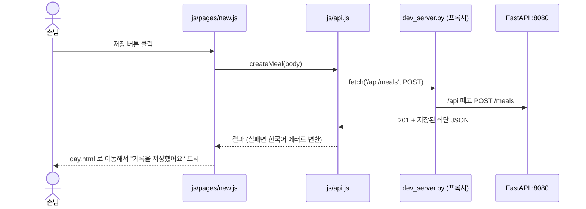
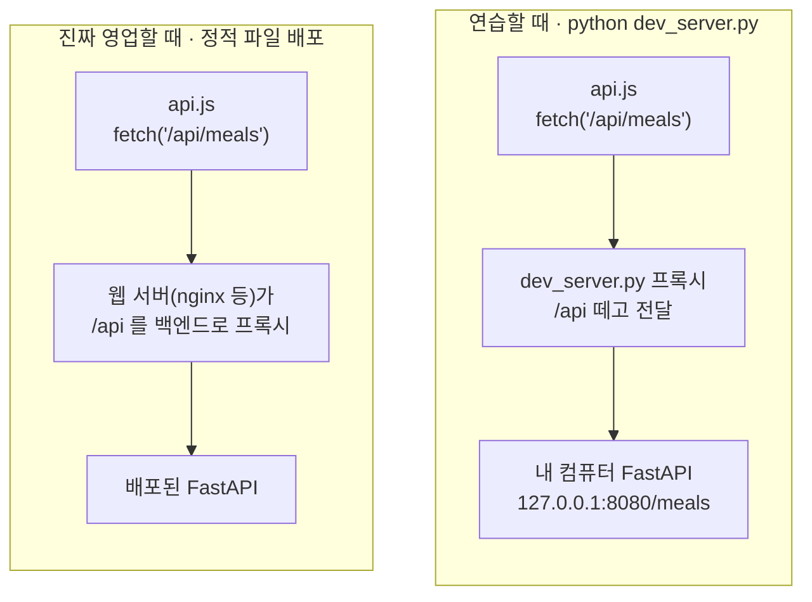

# 프론트엔드 안내서

> 프론트엔드는 식당의 **홀**이에요. 손님이 보는 화면을 그리고, 손님이 주문하면 주문서를 써서 **주방(백엔드)** 에 보내요.
> 홀에는 **냉장고(DB)** 가 없어서, 재료는 언제나 주방에 부탁해야 해요.

백엔드 쪽 설명은 [../fastapi/GUIDE.md](../fastapi/GUIDE.md)에 있어요.

## 1. 등장인물

| 비유 | 실제 | 하는 일 |
|---|---|---|
| 손님 | 브라우저 | 버튼을 누르고 화면을 봐요 |
| **홀** | `frontend` (localhost:5173, `dev_server.py`) | 화면을 보여 주고, 주문서를 써서 보내요 |
| **주방** | `fastapi` (localhost:8080) | 주문서를 읽고 처리해서 돌려줘요 |
| **냉장고** | MySQL DB | 회원·식단 데이터가 보관돼 있어요 |

## 2. 큰 그림


- 주방과 냉장고는 `create_engine`으로 **계속 연결**돼 있어요.
- 홀과 주방은 연결해 두지 않아요. 필요할 때마다 **주문서 한 장을 보내고, 답장 한 장을 받으면 끝**이에요. 편지를 주고받는 것과 같아요.
- 냉장고 열쇠(`DATABASE_URL`, `create_engine`)는 **주방만** 가지고 있어요. 홀은 DB를 전혀 몰라요.

## 3. 폴더 지도

백엔드와 이야기하는 곳은 **`js/api.js` 딱 한 군데**예요. 나머지는 홀 안에서 화면을 꾸미거나 기억하는 일을 해요.
React·Vite 같은 도구 없이 html·css·js 파일만 있어요. 설치할 것도, 빌드할 것도 없어요.

```
frontend/
├─ index.html, login.html …  방(테이블)       화면 하나 = html 하나. 내용은 js/pages/*.js 가 그려요
├─ dev_server.py              연습용 중계 직원  파일을 보여 주고 /api 요청을 8080으로 전달
├─ css/                       인테리어         색·글꼴·간격 (tokens.css) + 화면별 스타일
│
└─ js/
   ├─ pages/                  방마다 담당 직원  화면별 스크립트 (dashboard.js, new.js …)
   ├─ ui.js, layout.js        숟가락·접시      여러 화면에서 같이 쓰는 부품 (버튼, 입력칸, 헤더)
   ├─ plate.js                그림 담당        메뉴 글자로 접시 그림 만들기
   ├─ auth.js                 입구 직원         누가 로그인했는지 기억 + 비로그인 손님 막기
   ├─ data.js, date.js, meal.js  계산기         날짜 계산, 날짜별로 묶기 (주방과 무관)
   │
   ├─ config.js               주방 주소         API_BASE_URL (기본 '/api')
   └─ api.js                  ★ 주방과 통신     주문서 양식 + fetch()로 실제 전송 + 에러를 한국어로 변환
```

## 4. 따라가 보기: "아침 · 김밥 저장" 버튼을 누르면



실제로 보내는 주문서:

```http
POST /api/meals
Content-Type: application/json

{ "user_id": 1, "type": "breakfast", "menu": "김밥", "date": "2026-11-25" }
```

## 5. 주문서 생김새

주문서에는 세 가지가 적혀 있어요.

| 칸 | 설명 | 예 |
|---|---|---|
| **어디로** | 주소(경로) | `/users/abc` |
| **무엇을** | 동사(메서드) | `GET` `POST` `PUT` `DELETE` |
| **내용** | JSON 데이터 (조회할 때는 없음) | `{"menu": "김밥"}` |

`get`, `create` 같은 동작은 주소에 쓰지 않고 **동사**로 보내요. 같은 주소라도 동사가 다르면 주방의 다른 함수가 받아요.

| 동사 | 뜻 | 주소 | 프론트 함수 | 쓰는 화면 |
|---|---|---|---|---|
| `GET` | 보여 줘 | `/users/{userid}` | `getUser` | 로그인 |
| `GET` | 보여 줘 | `/meals/user/{user_id}` | `getUserMeals` | 대시보드, 날짜 상세 |
| `POST` | 새로 만들어 줘 | `/users/signup` | `signup` | 회원가입 |
| `POST` | 새로 만들어 줘 | `/meals` | `createMeal` | 식단 등록 |
| `PUT` | 고쳐 줘 | `/users/{userid}` | `updateUser` | 내 정보 |
| `DELETE` | 지워 줘 | `/users/{userid}` | `deleteUser` | 내 정보(탈퇴) |

답장 숫자: `200`/`201` 성공 · `404` 못 찾음 · `409` 이미 있음 · `422` 주문서를 잘못 씀 · `500` 서버 오류

## 6. 연습할 때 vs 진짜 영업할 때



- 배포할 때는 `frontend` 폴더를 **그대로** 서버에 올리면 돼요. 빌드 과정이 없어요.
- 백엔드를 다른 주소로 직접 부르고 싶으면 `js/config.js`의 `API_BASE_URL`을 바꿔요. 이때는 아래 경비원(CORS) 문제가 생겨요.

### 경비원(CORS)
브라우저에는 "지금 보고 있는 사이트가 아닌 다른 주소로 요청하면 막는다"는 경비원이 있어요.
- **연습할 때**: 브라우저는 같은 5173에 요청한 것으로 알고, `dev_server.py`가 대신 8080에 전달해요. 그래서 막히지 않아요.
- **배포할 때**: 프론트와 백엔드 주소가 다르면, FastAPI가 `CORSMiddleware`의 `allow_origins`에 프론트 주소를 허용해야 해요.

## 7. 자주 헷갈리는 것

**Q. `/api`는 왜 붙여요? 꼭 api여야 해요?**
5173 서버에는 "화면 주세요"와 "백엔드에 전해 주세요" 요청이 섞여 들어와요. `/api`가 붙은 것만 백엔드로 보내자고 정한 **꼬리표**예요. 이름은 아무거나 괜찮아요. `js/config.js`의 `'/api'`와 `dev_server.py`의 `'/api'`만 같게 맞추면 돼요. 백엔드에 갈 때는 떼고 가요.

**Q. html 파일을 더블클릭해서 열면 안 돼요?**
안 돼요. `<script type="module">`은 `file://`에서 막혀요. 그리고 백엔드 주문도 보낼 곳이 없어요. `python dev_server.py`로 열어 주세요.

**Q. 로그인할 때 비밀번호를 확인해요?**
아직은 안 해요. 백엔드에 로그인 API가 없어서 `GET /users/{userid}`로 그런 회원이 있는지만 확인해요. 로그인 API가 생기면 `js/auth.js`의 `login()`만 바꾸면 돼요.
